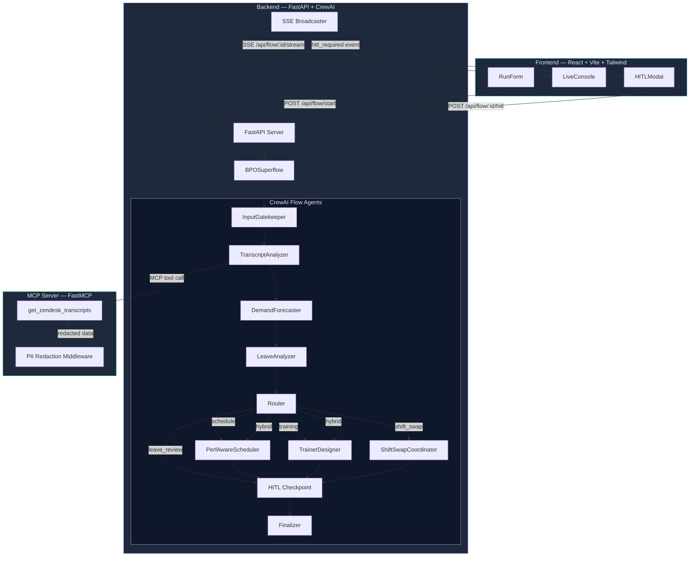
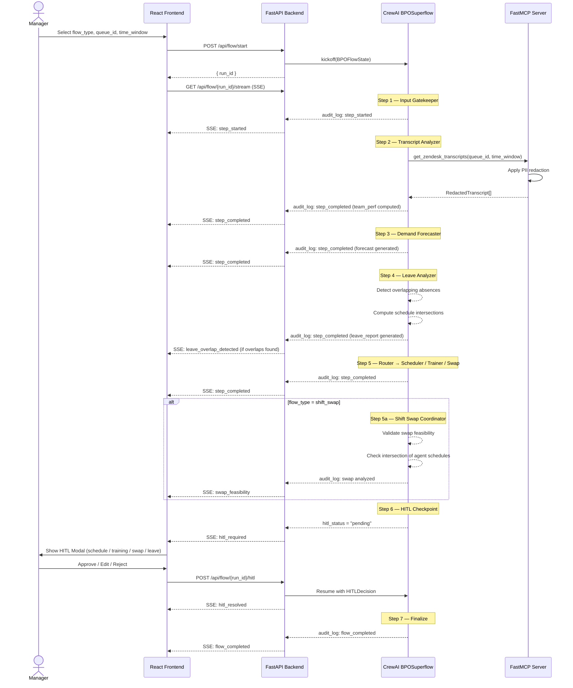
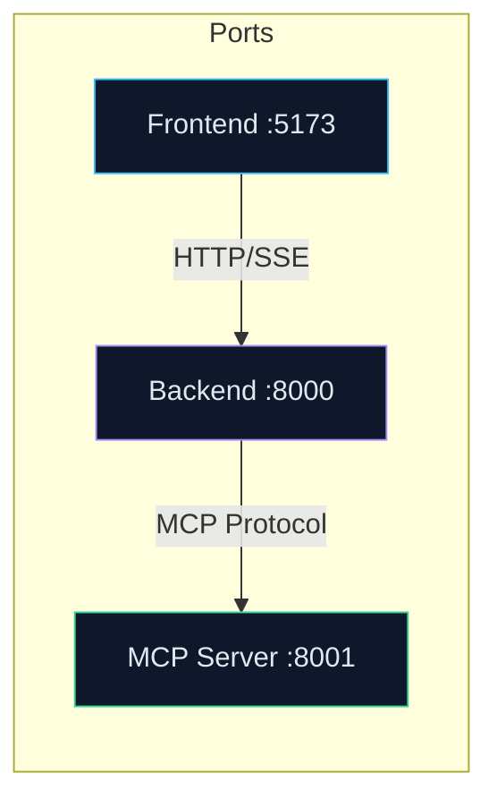
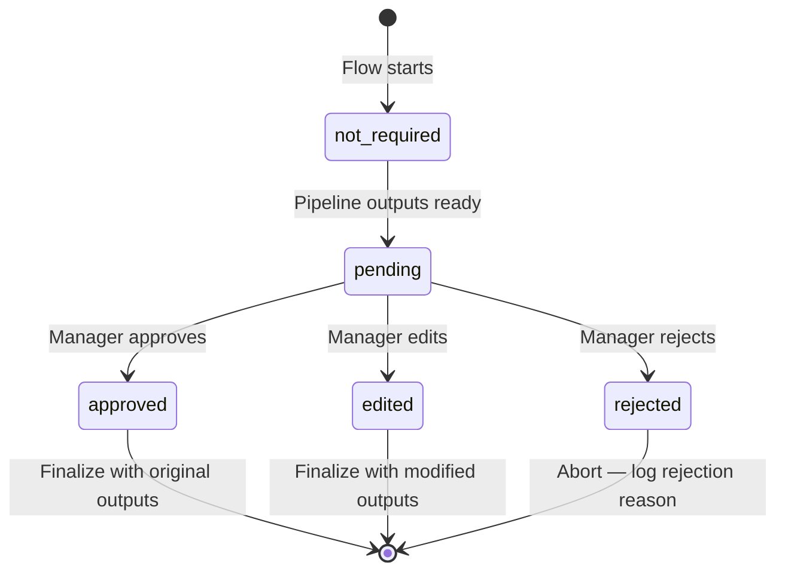
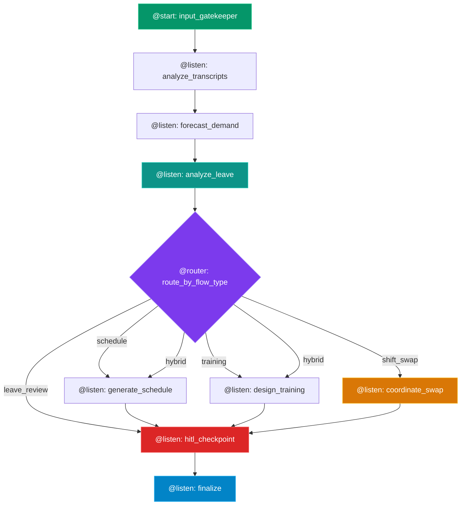

# BPO Ops Superflow — Architecture

> **Version:** 0.1.0 (Scaffold)
> **Date:** 2026-02-24

---

## 1. System Architecture



---

## 2. Data Flow Sequence



---

## 3. Directory Structure

```
crewai-bpo-challenge/
├── docs/
│   ├── project_specs.md          # This specification
│   ├── architecture.md           # This document
│   └── crewai_cheatsheet.md      # Existing reference
│
├── backend/
│   ├── Dockerfile
│   ├── requirements.txt
│   ├── main.py                   # FastAPI app + SSE endpoints
│   ├── models/
│   │   ├── __init__.py
│   │   └── state.py              # Pydantic models (BPOFlowState, etc.)
│   ├── agents/
│   │   ├── __init__.py
│   │   ├── transcript_analyzer.py
│   │   ├── demand_forecaster.py
│   │   ├── leave_analyzer.py
│   │   ├── perf_aware_scheduler.py
│   │   ├── shift_swap_coordinator.py
│   │   └── trainer_designer.py
│   └── flow/
│       ├── __init__.py
│       └── bpo_flow.py           # BPOSuperflow (CrewAI Flow class)
│
├── frontend/
│   ├── Dockerfile
│   ├── package.json
│   ├── vite.config.ts
│   ├── tsconfig.json
│   ├── index.html
│   └── src/
│       ├── App.tsx               # Main layout
│       ├── main.tsx              # Entry point
│       ├── types.ts              # TypeScript interfaces
│       └── components/
│           ├── RunForm.tsx       # Flow initiation form
│           ├── LiveConsole.tsx   # SSE-powered audit timeline
│           └── HITLModal.tsx     # Approve / Edit / Reject modal
│
├── mcp_server/
│   ├── Dockerfile
│   ├── requirements.txt
│   └── server.py                 # FastMCP server + Zendesk tool + PII middleware
│
├── docker-compose.yml            # Orchestrates all 3 services
├── .env.example
├── .gitignore
├── mock_data/                    # Existing mock datasets
│   ├── tickets.json
│   ├── agent_metrics.json
│   └── campaigns.json
├── example_flow.py               # Existing reference (do not modify)
├── verify_setup.py               # Existing setup check
└── README.md
```

---

## 4. Service Communication



| Service | Port | Protocol | Upstream Dependency |
|---------|------|----------|-------------------|
| Frontend | 5173 | HTTP (Vite dev) | Backend |
| Backend | 8000 | HTTP + SSE | MCP Server |
| MCP Server | 8001 | MCP (stdio/SSE) | None (external Zendesk) |

---

## 5. API Endpoint Design

### 5.1 Flow Lifecycle

```
POST   /api/flow/start          → Start a new flow run
GET    /api/flow/{run_id}/state  → Get current state snapshot
GET    /api/flow/{run_id}/stream → Subscribe to SSE events
POST   /api/flow/{run_id}/hitl   → Submit HITL decision
```

### 5.2 Request / Response Models

#### `POST /api/flow/start`

```python
# Request
class FlowStartRequest(BaseModel):
    flow_type: Literal["training", "schedule", "hybrid", "leave_review", "shift_swap"]
    queue_id: str
    time_window: str  # e.g. "2025-W24"
    swap_request: Optional[SwapRequest] = None  # Required for shift_swap flows

# Response (201)
class FlowStartResponse(BaseModel):
    run_id: str
    status: str  # "started"
```

#### `POST /api/flow/{run_id}/hitl`

```python
# Request
class HITLDecisionRequest(BaseModel):
    decision: Literal["approve", "reject", "edit"]
    reviewer_id: str
    comments: str
    edits: Optional[dict] = None

# Response (200)
class HITLDecisionResponse(BaseModel):
    status: str  # "accepted"
    run_id: str
```

### 5.3 Error Responses

All errors use a typed `APIError` model — no unstructured error strings:

```python
class APIError(BaseModel):
    error_type: str    # e.g. "ValidationError", "FlowNotFoundError"
    message: str
    details: Optional[dict] = None
```

| Status | Error Type | When |
|--------|-----------|------|
| 404 | `FlowNotFoundError` | `run_id` doesn't exist |
| 409 | `FlowStateConflictError` | HITL decision on non-pending flow |
| 422 | `ValidationError` | Invalid request body |
| 500 | `InternalPipelineError` | Unrecoverable agent failure |

---

## 6. HITL State Machine



---

## 7. SSE Event Schema

All SSE events conform to a unified envelope:

```typescript
interface SSEEvent {
  event: "step_started" | "step_completed" | "hitl_required"
       | "hitl_resolved" | "flow_completed" | "flow_error"
       | "leave_overlap_detected" | "swap_feasibility";
  data: {
    run_id: string;
    timestamp: string;     // ISO 8601
    step?: string;         // Agent step name
    message?: string;      // Human-readable description
    payload?: Record<string, unknown>;  // Event-specific data
  };
}
```

---

## 8. CrewAI Flow Graph



Each node corresponds to a method on the `BPOSuperflow(Flow[BPOFlowState])` class. The HITL checkpoint is the **only** point where execution pauses for external input.

---

## 9. MCP Server Isolation

The MCP server is fully decoupled from backend logic:

| Concern | Implementation |
|---------|---------------|
| **No shared code** | Separate `requirements.txt`, separate Docker image |
| **No direct DB access** | Data sourced only from Zendesk API (or mock) |
| **PII never leaves MCP** | Redaction applied as middleware before tool returns |
| **Interface contract** | Tools: `get_zendesk_transcripts(queue_id, time_window) → list[RedactedTranscript]`, `get_agent_leave_data(queue_id, time_window) → list[AgentLeave]` |

The backend connects to the MCP server using the standard MCP client protocol. The MCP server knows nothing about CrewAI, schedules, or training plans.

---

## 10. Deployment Topology (Docker Compose)

```yaml
services:
  mcp_server:    # Port 8001, no external deps
  backend:       # Port 8000, depends_on: mcp_server
  frontend:      # Port 5173, depends_on: backend
```

All services share an `.env` file for API keys but are otherwise stateless. No persistent storage is needed for the scaffold phase.
